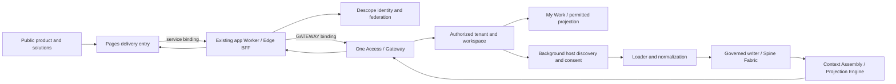

# SpineWorkspace entry, identity, and Pages delivery

Status: proposed downstream implementation specification; awaiting written review.
Date: 2026-10-10.
Source baseline: `SpineInnovLabs/spineworkspace-live@f5dffed1bc2607a6b282856cbf59e6f007020af5`.
Parent branding in this work: Spine InnovTech / Spine InnovTech Private Limited, as directed by the founder. Existing repository identifiers remain unchanged.

## Intended outcome

A person can read the public Product, functional Solution, and industry Solution pages, choose Sign up or Sign in, authenticate through Descope, and enter their authorized workspace. A permitted host identity can be federated through Descope. When that method is unavailable, the configured social methods remain available. Host discovery and tool connection happen after entry without a mandatory setup wizard.

Connected, authorized context flows through the existing loader, normalization, governed writer, Spine Fabric, Context Assembly, and projection services. The frontend renders those projections through the server boundary. The founder requested Cloudflare Pages for frontend delivery.

The first implementation covers entry and one connected-context journey. It does not rewrite every service, create separate apps per industry, or change the fixed workspace navigation grammar. Further providers and domain journeys extend the same contracts after this first journey is demonstrated.

## Evidence and current limits

The following observations distinguish source behavior from verified deployed behavior. Repository-relative references below refer to the pinned `spineworkspace-live` baseline.

| Area | Evidence | Assessment |
| --- | --- | --- |
| Descope sign-in | `apps/web/components/auth/descope-flow.tsx` uses `sign-up-or-in` and exchanges the credential with `/api/auth/session`; the session route validates it through the Descope SDK | Implemented in source; an actual authenticated journey has not been exercised in this session |
| Federated identity | `packages/auth/src/index.ts` states that enterprise SAML/OIDC providers federate behind Descope and that discovery requires separate authorization | Contract exists; enabled social/SSO methods in the deployed Descope project are unknown |
| Return paths | Login preserves `next`; signup reads `next`, but its existing `/login` cross-link omits it (`apps/web/app/signup/page.tsx`) | Partial; context can be lost when switching authentication mode |
| Direct entry | `apps/web/proxy.ts` checks a completed onboarding cookie under production strict mode; `lib/auth/post-auth-destination.ts` directs an identity without a tenant to onboarding | Conflicting with the current immediate-My-Work requirement; membership provisioning must remain an authorization prerequisite |
| Membership | `lib/auth/session-identity.ts`, Gateway One Access, and tenant contracts resolve verified membership without a default tenant | Source contract exists; new-user, returning-user, and multiple-tenant outcomes require actual journey evidence |
| Host discovery | `/api/onboarding/host-discovery` reads Gateway `/api/v1/integrations/host-estate`; hosts without a verified report remain declared, and `externalAccounts` is currently empty | Partial; this is not complete discovery of a person's connected external accounts |
| Workspace discovery | `services/gateway/src/platform-discovery.ts` discloses unresolved capabilities and unavailable connection/catalog summaries | Implemented in source; absence must remain distinct from denial and temporary unavailability |
| Projection loading | `lib/projection-route-loader.ts` validates projection/tenant/workspace/principal consistency and source-tenant provenance; `lib/server/gateway-transport.ts` prefers `GATEWAY` | Implemented in source; preserve this path |
| Live Worker | Cloudflare settings API confirmed `spineworkspace-web` has assets, public Descope configuration names, and `GATEWAY → spineworkspace-gateway` | Deployment binding observed; a binding alone does not prove downstream business behavior |
| Pages | Cloudflare projects can be listed with the injected token; Pages Functions support Worker service bindings | Account read access observed; a new Pages deployment has not been created |
| Ingestion | `services/loader/src/index.ts`, `services/pipeline/src/normalizer/normalize.ts`, and the canonical writer contain the ingestion/normalization paths | Source exists; this session has not submitted a real authorized source record or verified its readback |

The public app login/signup endpoints returned HTTP 200, while `auth.spineworkspace.com/login` returned 404. Marketing therefore uses the existing app origin. HTTP 200 does not prove authentication succeeded.

## Delivery options and selected proposal

| Option | Benefit | Cost / limitation |
| --- | --- | --- |
| Pages frontend entry through a Function service binding to the existing OpenNext app Worker | Meets the requested Pages delivery entry while preserving Next server components, session routes, and private Worker bindings | Adds one thin delivery hop; requires origin, cookie, streaming, and cache validation |
| Keep the complete frontend on Workers Static Assets | Matches the accepted current hosting ADR and the deployed architecture | Does not deliver the requested Pages entry |
| Convert apps/web into a static client app on Pages | Pages directly hosts the client application | Replaces load-bearing server behavior and requires a substantially larger migration; excluded from this first slice |

Selected proposal: the Pages delivery entry with the existing Worker as the sole application server. Cloudflare's Next.js Pages guide directs full-stack applications to Workers; a static export cannot preserve this app's server session and projection loaders. Pages Functions officially support `context.env.SERVICE.fetch(context.request)`.

`ADR-2026-10-03-01` currently specifies Workers hosting. The founder's latest request extends delivery to Pages, so the implementation must record a narrowly scoped delivery ADR in `spineworkspace-live`. It preserves Worker-owned application/BFF behavior and the existing single Workbench runtime. It does not silently edit the constitutional canon.

## Authentication and entry behavior

1. Public feature pages retain their content. Sign up and Sign in are prominent actions. Product navigation remains a public product-details link unless the founder explicitly chooses an authentication-only navigation door.
2. Both authentication URLs carry a fixed app-local `next` path. Functional solutions request their registered projection; industry pages without a registered projection request My Work. No industry hostname or entitlement is invented.
3. Sign-up/sign-in cross-links, the Descope flow, callback, and server session exchange preserve the sanitized return path. External and protocol-relative return URLs are rejected by the shared contracts.
4. A permitted federated host/enterprise method uses the configured Descope connection. A hostname, email suffix, or claimed host identity alone never authorizes it. Unconfigured methods are not offered as working methods.
5. When that federation method is unavailable, configured social Descope methods are offered. An explicit identity/authorization denial must be shown; the application must not silently substitute another identity to bypass it.
6. The server validates the Descope credential and resolves tenant/workspace membership. Existing users enter their authorized workspace directly. Multiple memberships require explicit selection of an authorized tenant. A new user receives an authorized provision/create/join outcome through One Access; failure does not create a default or Customer Zero membership.
7. Only the identity/membership requirement can block entry. Connection discovery, hydration, plugin selection, and completion of a setup checklist do not block My Work. Removing the onboarding-cookie gate must not remove server membership or projection authorization checks.
8. An unauthorized requested projection displays the access outcome and an available authorized workspace entry. It never renders another tenant's data. Server resolution remains authoritative over the marketing hint.
9. Logout clears the applicable app session. Returning sign-in re-resolves membership and current permissions rather than restoring cached authority.

## First connected-context journey

Use Account Success as the first validation projection, without narrowing the product to renewals. A supported source supplies a customer/account plus a related support or activity record under a real, consenting tenant. The workspace should show source-labeled account context and freshness. Other public solution pages retain their distinct domain features and authenticated entry links.

Discovery consumes verified host-estate reports and separately authorized tool/provider connections. It cannot enumerate a host's private tools merely because the person signed in with Google, Okta, or Auth0. Connection ownership and provider credentials remain with the owning host/managed provider; Spine stores references, grants, health, provenance, and evidence.

Flow D must establish identity, tenant, consent, policy, and eligible binding before data enters Loader. Structured records follow validation, mapping, entity resolution, deduplication, and governed promotion. Unstructured evidence retains source references and joins structured context only through the authorized projection. Discovery never writes canonical truth or grants execution.

The browser requests same-origin application endpoints. Server calls use the existing Worker binding transport. RPC is used only where an existing typed service interface supports it; HTTP `fetch` over a service binding remains valid for current Gateway contracts. The browser receives neither bindings nor raw datastore/provider credentials.

Unavailable sources show a disclosed gap; denied sources show denial; stale context shows freshness. Demonstration fixtures are labeled and cannot satisfy live acceptance. The first read journey does not trigger an external write. A later consequential action remains Capability → Govern → Hermes → independent readback → reconciliation.

## Pages boundary and rollout

- A dedicated Pages preview entry binds to the TEST app Worker. Production and preview bindings cannot share a production tenant/data shortcut.
- Pages serves eligible public/static frontend assets and forwards dynamic application requests to the app Worker. Login, signup, session, callback, authenticated HTML/RSC, API requests, and logout preserve method, body, cookies, query, response status, streaming, and Set-Cookie behavior.
- Signed identity and tenant decisions remain on the server. Client-supplied tenant, role, projection-authority, or forwarded-host headers cannot become trusted claims. The origin contract must explicitly support the Pages preview hostname without presenting it as an authorized tenant or industry.
- Authenticated responses and session/projection APIs are private and not stored in shared cache. Static assets may retain immutable caching. Do not add a blanket SPA fallback that bypasses protected routes or returns HTML for APIs.
- Callback/SSO allowlists use the exact tested frontend origins. A Pages-host session is not assumed to exist on a different host because `iw_session` is host-only.
- Preview must pass before the `app.spineworkspace.com` custom-domain handover. There remains one frontend runtime for domain aliases; separate Pages apps per department are unnecessary.
- The app domain, existing Work aliases, Pages entry, and Worker asset build are treated as a coordinated release. Preserve the known Worker deployment and domain configuration as rollback targets. Roll back delivery routing if session exchange, projection authorization, or asset loading fails.
- Marketing publication is independent and can use its already-working Cloudflare native deployment. This spec does not authorize an unverified replacement of the live workspace.

## UI requirements

Use the approved white/pale-blue surfaces, navy headings, bright-blue buttons, readable type, and consistent focus states for apps/web entry and the first tested workspace surface. Retain the fixed primary sidebar and domain projection contracts. New visuals must be original and relevant; the supplied screenshots are design references, not assets to embed.

Authentication explains only the choice the person needs to make. Discovery appears in Connected Ecosystem with available, consent-needed, denied, revoked, unavailable, and synchronizing states. Service names, worker topology, configuration hashes, and normalizer/RPC details belong in diagnostics rather than the everyday entry flow.

## Acceptance and evidence

The first slice is accepted when a real user completes the following on the deployed preview and then the production release:

1. Arrives from Product, a functional Solution, and an industry Solution with the intended entry context; switches sign-up/sign-in without losing it.
2. Uses a configured permitted federation method, or a configured social Descope method when federation is unavailable. The server rejects an invalid/expired credential and an unsafe return URL.
3. Resolves a valid tenant/workspace and opens My Work or the permitted projection without completing tool setup. An independent second tenant cannot retrieve the first tenant's projection or connected records.
4. Discovers only verified/authorized host estate, consents to a supported source, and sees its real record after loader/normalization/governed promotion with provenance and freshness. Missing permission, revoked connection, and source failure are disclosed.
5. Receives the projection through the Pages → app Worker → Gateway binding path. Browser network inspection shows no raw internal datastore calls or provider credentials. Session cookies, CSRF/origin checks, private cache rules, streaming, and asset loading behave correctly.
6. Logs out, signs back in, and resumes the correct workspace with current permissions. Desktop, tablet, mobile, keyboard, loading, empty, denied, and error states pass the repository visual and accessibility checks.

Record source commit, build/deployment identity, redacted screenshots, route outcomes, trace/correlation references, data provenance, and isolation results. Build success and HTTP 200 are separately recorded and cannot substitute for this journey.

## Requirements for execution

The Cloudflare token is present and verified active via the supported proxy. Account listing and Worker binding reads work; Pages write capability will be checked when the reviewed implementation needs it. No duplicate token request is needed.

Deployed Descope provider availability, a real authorized test user/tenant, and a supported consenting source connection remain unverified. Inspect existing secure configuration metadata first. Any missing identity/provider configuration should be supplied through the existing Descope/vault/environment administration path, never as credentials pasted in chat.

Follow spineworkspace-live's feature → dev → staging → main promotion discipline, affected contract tests, changelog/evidence obligations, and live-journey release gate. Its current repository is available for source inspection; its dependency install, startup, test suite, and new-task restoration have not been validated in this session. The marketing environment is separately build-tested.
